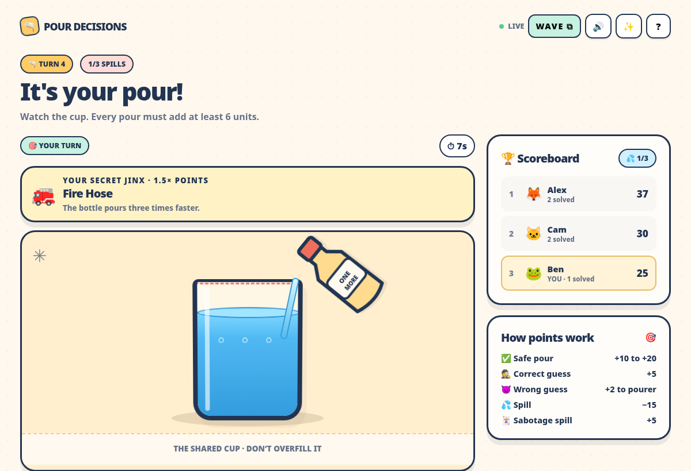
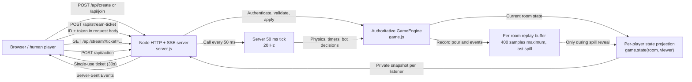

# 🫗 Pour Decisions

[](https://github.com/erasmorivas3540/pour-decisions/actions/workflows/ci.yml)

**A real, server-authoritative, multiplayer party game.** Two to eight friends join the same room on separate phones or laptops, secretly jinx one another, carefully fill a shared cup, and try to identify the jinx. No login or install.



## Play online

**Live multiplayer game:** https://pour-decisions-ozbh.onrender.com

## Quick start (Node.js 20+)

No runtime dependencies, database, or API keys required. Development tooling is optional.

```bash
npm start
```

Open **http://localhost:3000** in a browser. Create a room and share the four-letter code with a friend, or have the host add a bot in the lobby. Games need at least two seated players, including bots. Locally, use two **independent browser profiles** (or use `?room=CODE&new=1` in separate tabs to force a new seat). The host can start once two seated players are present (human clients connected and bots occupying engine-managed seats).

**Important:** localhost is only accessible from your machine. To meet the contest's publicly accessible URL requirement, deploy this Node server to an Internet hosting platform, as described below.

## Deploy publicly (Render)

This repository contains `render.yaml` for a single-instance web service.

1. Create a GitHub repository and add these project files to its root.
2. In [Render](https://dashboard.render.com/), select **New → Blueprint**, connect the repository, and choose the included `render.yaml`. Alternatively, create a **Web Service**, set runtime **Node**, build command `npm install --omit=dev`, and start command `npm start`.
3. Choose a **single Node.js instance** (the included Blueprint defaults to Render Free) and complete deployment. Copy the resulting HTTPS address (`https://your-service.onrender.com`).
4. Open the HTTPS address on two different devices and share invite links. Submit that address as your Handshake project URL.

The health check is `GET /health`. Hosting must support long-lived HTTP responses / **Server-Sent Events (SSE)**. Keep **one running server instance**: rooms are stored in memory, not a shared database. An instance restart clears open rooms. On Render Free, a sleeping service loses active room sessions and can have cold-start delays; consider a paid always-on instance only if you approve the cost. Production uses `GAME_TIME_SCALE=1` (the default).

You can also deploy the supplied `Dockerfile` to Railway, Fly.io, a VM, or any platform running a long-lived Node server; set `PORT` to the service's provided port (defaults to 3000). Static-only hosting such as GitHub Pages **will not work** because the game requires a live Node backend.

## Two-player head-to-head mode

Two players can now start immediately. One pours while the other watches. After the first round (which uses a random jinx), the previous pourer chooses one of three jinxes to sabotage the opponent. Because the jinxer already knows the secret, **guessing is skipped in two-player games**, and reveals follow pours immediately. Safe pour points, spill penalties, sabotage points, and the host-selected spill limit work as usual. If fewer than two seated players remain connected, the game pauses until one reconnects. Rooms still support up to eight players, with the original guessing game for three or more players.

## How to play

**No rules timer:** At the beginning of a game, every player can read all three illustrated rule slides for as long as they need. The server starts gameplay only when all connected human players have tapped **I’m ready**. Bots are ready automatically. There is no automatic rules-screen timeout.

1. **Jinx:** After the first turn, the previous pourer picks 1 of 3 secret jinx cards for the next pourer. Only those two see the true jinx before reveal. The first turn gets a randomly selected jinx.
2. **Pour:** Hold to pour and release to finish. Each turn adds at least 6 units, and going over 100 spills the cup. Start within 10 seconds; each active pour lasts up to 12 seconds (Eyedropper lasts up to 8). Normal pouring is 3 units/second, four times slower than the original build; Fire Hose is 9 units/second and Eyedropper is 1 unit/second. **Opposite Day** automatically pours and holding pauses the flow; press **Finish this pour** to stop it.
3. **Guess:** Other players choose from four possible jinxes while watching; guesses lock five seconds after pouring ends. Correct guesses earn +5. The pourer earns +2 per wrong guess.
4. **Score:** A safe pour earns 10/15/20 points based on difficulty. Spill: −15; the jinxer gets a +5 sabotage bonus. Spills empty the cup; everyone stays in. End after 3, 5, or 7 spills (host setting). Score ties break by correct guesses, then equal-handicap sudden-death pours.

## New overhead view and distance handicap

During every live pour, **the active pourer sees the cup from overhead**, while every other player sees a **side view** of that same shared cup. The two cameras switch automatically when the next player pours, retaining the same synchronized water level. The pourer’s overhead view uses a photographic measuring-cup sprite sheet with 16 fill-progress frames, a settled-water atlas, and animated transitions. **5 Feet Above** is a new Distance-family jinx worth **1.5×**: only the pourer sees the glass pulled farther away. All other vision, hand and bottle handicaps stay in the game, and the server still owns water physics.

## Features

- Four-letter room code, invite URLs, nicknames up to 12 characters, emoji avatars, duplicate-name numbering.
- 2–8 seated players, including up to three **🤖 host-managed bots**, and optional spectators; join in progress, guessing from the following turn, and entry into the rotation at the next cup if there is a seat.
- **All 13 jinxes**: Foggy Glasses, Tunnel Vision, Lag Goggles, Lights Out, 5 Feet Above, Shaky Hands, Heavy Arm, Opposite Day, Butterfingers, Fire Hose, Eyedropper, Ketchup Bottle, Soda Can.
- Server-owned 20 Hz cup updates, hidden role data, authoritative scoring, card selection and timers, anti-duplicate-guess checks, and per-session credentials.
- Single-use, 30-second SSE tickets requested by authenticated POST and per-player action/ticket rate limits (separate per-IP creation/join limits).
- **▶ Watch the spill** on reveal: side-view replay at 1×/2× with jinx events and the exact final water level. Replay is limited to 400 samples per turn, hidden until reveal, and cleared on rematch.
- Reconnection into the same seat on refresh, minimum drip on disconnect, 2-second grace for a refreshing host, host transfer after departure, 2-minute pause after fewer than 2 players remain, rematch and same-room replay.
- Three illustrated instruction cards with unlimited reading time and per-player readiness, overhead pourer and side-view spectator cameras with synchronized slow water, mobile-friendly design, reduced motion, optional sounds, SSE updates, results, leaderboards, awards, and screenshot cover art.
- No third-party **runtime** dependencies or account sign-ins.

## Engineering highlights

- **Server authority:** `game.js` owns the cup physics, scores, timers and engine-controlled bots. The 50 ms server tick advances the shared game at 20 Hz.
- **Secure, reconnectable SSE:** `POST /api/stream-ticket` authenticates seat credentials in the request body and issues a 30-second, single-use capability for `GET /api/stream?ticket=…`. Every reconnect requests a new ticket; the durable token is never in the stream URL.
- **Privacy and bounded replays:** `game.state(room, player)` projects each viewer's allowed state. It hides unrevealed jinxes and gives out the latest spill's capped replay only during reveal.
- **Verification:** Prettier and `npm run check` run in CI on Node 20 and 22; a separate HTTP/SSE load harness measures complete concurrent matches. Details: [engineering notes](docs/ENGINEERING_NOTES.md) and [measured load tests](docs/LOAD_TEST.md).

## Architecture



The server consumes each stream ticket exactly once and sends a separately **filtered** snapshot to each authenticated listener; the room code alone does not authorize a stream. Secret jinx details and replay samples never reach guessers before reveal. Bots act inside the engine rather than opening HTTP connections. Rooms and the latest spill replay live in one Node process's memory, so a restart clears them. The visual foam effect of *Soda Can* remains visible to everyone, as designed.

### Project files

- `server.js`: zero-dependency Node HTTP/SSE server, secure static file serving, action endpoints.
- `game.js`: game room engine, rules, authority and timed effects.
- `public/`: web UI (HTML, CSS, JS) and favicon.
- `tests/engine.test.js`: game/edge-case regression tests.
- `tests/bots.test.js`: bot management, game completion, turn permissions and room expiry.
- `tests/replay.test.js`: replay secrecy, cap, final level, events and UI checks.
- `tests/load.mjs`: separate real HTTP/SSE load benchmark (excluded from `npm test`).
- `docs/ENGINEERING_NOTES.md`: defect log and regression evidence.
- `docs/LOAD_TEST.md`: dated load-test methods and measured results.
- `.github/workflows/ci.yml`: Node 20 and 22 formatting and tests.
- `tests/pacing-and-guide.test.js`: explicit no-timeout onboarding, all-player readiness, slow-flow rate and minimum-trickle regression tests.
- `tests/integration.test.js`: three actual simultaneous HTTP/SSE clients and private-info checks.
- `tests/render_preview.py`: offline Chromium visual previews of the shipped UI; generates screenshots in `artwork/`.
- `tests/browser_smoke.py`: optional full web-browser walkthrough on a machine where Chromium allows localhost access.
- `artwork/cover.png`: Handshake cover image (game UI rendering with sample game state).
- `SUBMISSION.md`: copy-ready Handshake title/description and submission instructions.
- `TEST_REPORT.md`: scope and limitations of completed verification.

## Testing

```bash
npm run check
```

This runs syntax checks and **39 Node tests** (verified October 15, 2026), including real HTTP/SSE integration clients, bot gameplay, replay privacy, and rate-limit coverage. CI runs the checks on Node 20 and 22.

Run `npx prettier --check .` to verify formatting. The separate load test defaults to 20 concurrent full games, each with two human HTTP/SSE clients and two bots:

```bash
npm run loadtest
```

Load testing is excluded from `npm test` and `npm run check`. See the measured results in [docs/LOAD_TEST.md](docs/LOAD_TEST.md).

Optional UI screenshot test if Python Playwright and Chromium are available:

```bash
python tests/render_preview.py
```

Optional end-to-end browser walkthrough (requires a locally reachable Chrome/Chromium):

```bash
npm start
python tests/browser_smoke.py
```

The hosted page should be checked on a real iPhone, Android, and laptop before final submission. No claim is made here that real devices or a public service were tested from this build environment.

## Limitations / operations

- Open rooms do **not** persist across service restarts or deployment changes; server instances are not horizontally shared.
- Rooms with no connected human users close after 30 minutes of inactivity; engine-owned bots do not keep abandoned rooms alive. A temporary network loss is recoverable while the same backend process remains online.
- Keep the service up for the game and avoid very aggressive platform idle timeouts. If the service requires an SSE idle/response timeout, configure it above a few minutes; streaming emits state at least four times per second.
- This is an age-neutral cartoon game using water, not actual drinking.
- The production service is already deployed to Render under the owner’s account. A Render restart or free-plan spin-down can reset in-progress rooms.

## Photographic pour sprites (October 2026)

The active pourer uses an overhead sprite-sheet animation derived from the user-provided measuring-cup artwork. The app selects neighboring frames from the authoritative server water level, animates ripples and bubbles while water flows, and uses a settled-water atlas when pouring stops. The other players continue to see the side camera. Exact fill totals and tick-mark labels are hidden during pouring; players must estimate the remaining capacity from what they observed previously. The new 16-frame 4×4 WebP atlas (`overhead-water-sprites-16.webp`) provides smoother, level-progressive pouring, with crossfades between neighboring photographic frames. The existing eight-frame settled-water atlas stays in place for non-pouring moments so the stream vanishes when the player stops. The optimized WebP assets in `public/assets/` are needed for the game. These are supplied project artwork, not an Envato video asset.
